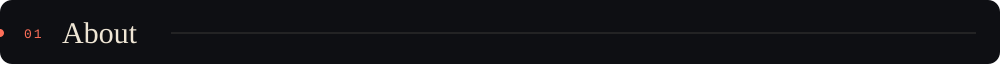
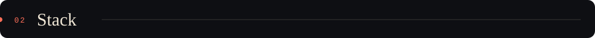
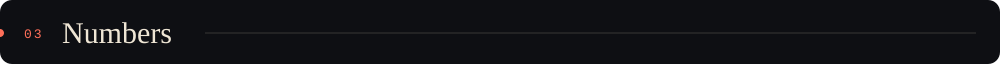
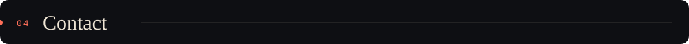
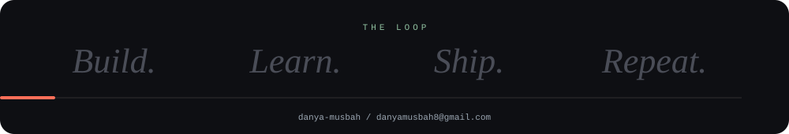

<div align="center">



</div>

<br/>



```text
danya/
├── build/      full-stack apps and REST APIs
├── analyze/    data analytics and data science
├── model/      machine learning, NLP, AI engineering
├── python/     intelligent applications
└── store/      databases, backend systems, architecture
```

<table align="center">
  <tr>
    <td width="150" align="center"></td>
    <td>Turning ideas into functional, well-designed software, exploring new technologies, and building projects that solve real-world problems.</td>
  </tr>
  <tr>
    <td width="150" align="center"></td>
    <td>Building and sharing projects to strengthen my engineering skills and create meaningful software.</td>
  </tr>
  <tr>
    <td width="150" align="center"></td>
    <td><b><i>Build. Learn. Ship. Repeat.</i></b></td>
  </tr>
</table>

<br/>




<br/>



<div align="center">

<a href="https://github.com/danya-musbah"></a>
<a href="https://github.com/danya-musbah?tab=repositories"></a>

<br/>


</div>

<br/>



<div align="center">

<a href="mailto:danyamusbah8@gmail.com"></a>
<a href="https://github.com/danya-musbah"></a>
<a href="https://www.linkedin.com/in/danya-musbah-87098838b/"></a>
<br/>
<a href="https://www.instagram.com/danya_musbah"></a>
<a href="https://www.youtube.com/@danya-musbah"></a>
<br/>
<a href="https://www.facebook.com/danya.musbah/"></a>
<a href="https://www.pinterest.com/242danya173/"></a>

<br/><br/>



<br/>


</div>

<!-- Proudly created with GPRM ( https://gprm.itsvg.in ) -->
